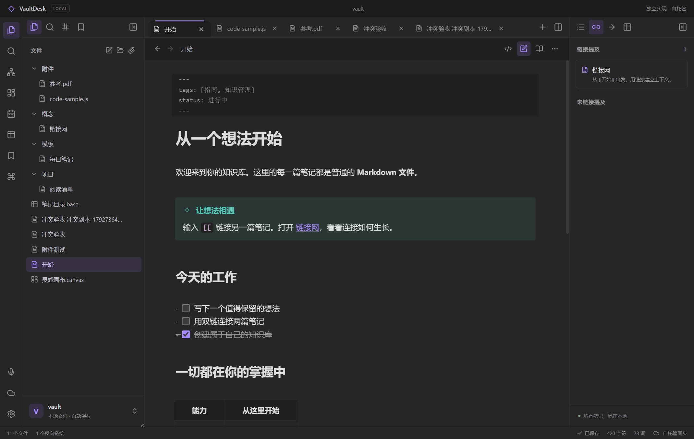
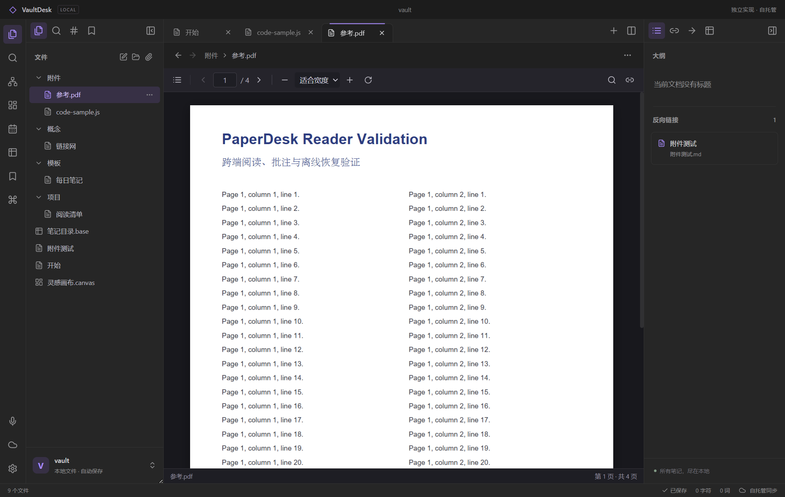

# Windows 开发预览验收（2026-10-23）

本轮交付是 `feature/obsidian-selfhosted` 上的独立 VaultDesk 0.1.0 开发预览，仍未达到完整 Obsidian 客户端/插件生态兼容。原 PaperDesk 客户端与后端不变。所有界面操作使用独立合成知识库，不使用用户笔记或原 Obsidian 云服务。

## 可复验的结果

| 层面 | 本轮结果 | 证据 |
| --- | --- | --- |
| REA 参考研究 | 原 ASAR 与 57 份有来源映射的片段分析；确认 31 个核心注册项 | [研究摘要](../research/README.md) |
| REA 独立客户端 | 启动、打开图谱、捕获图谱三步骤完成；只证明该场景 | [观察](../research/client-graph-observation.json) |
| Node 自动化 | `VAULTDESK_CLOUD_INTEGRATION=1 npm test`：86/86，通过且无跳过 | `output/final-tests.log`；[tests](../tests) |
| 参考链接语义 | 严格参考 218/218、便携核心 197/197、4 个负对照通过 | [语料与结果](../research/compatibility/README.md) |
| 云 API | pytest：19 passed、23 subtests passed；1 个测试客户端弃用提示 | [测试](../tests/cloud_test.py) |
| 真实双端同步 | 独立服务/两个本地库 10 项检查通过：文本、PDF 字节、CAS 冲突、离线副本、删除、历史恢复、发布更新与撤销 | [脱敏摘要](../research/cloud-sync-verification.json)、[复现脚本](../scripts/cloud-sync-smoke.mjs) |
| 原生文件操作 | Windows Electron 中创建中文路径文件，真实磁盘内容、刷新后持久化通过；重命名后 Markdown 入链随目标更新 | 合成库 `output/desktop-ui-*/vault`；本轮工具操作记录 |
| 编辑器 | 源码/实时/阅读、真实撤销、查找替换、checkbox回写、斜杠命令、hover、只读 | [详细记录](editor-ui-verification.md) |
| 插件 | 示例插件导入后禁用、显式启用、执行、显式停用、命令移除；有限接口 | [详细记录](plugin-ui-verification.md) |
| 工作区 | 浏览器保存“验收布局”，分屏后恢复单栏布局；重新载入后仍存在 | 本轮 Playwright CLI `vaultdesk` 操作 |
| 快捷键 | 为“管理工作区布局”录制 Ctrl+Alt+K；触发成功；重新载入后仍生效 | 本轮 Playwright CLI `vaultdesk` 操作 |
| 自定义 CSS | 通过设置保存自定义变量，computed style 读回预期值 | 本轮 Playwright CLI `vaultdesk` 操作 |
| 笔记重组 | 真实选择最后一段，跨目录提取，源文替换为链接；随后合并回原文，维护入链且源文回收 | 浏览器演示库的真实持久状态读回；[24 项规划测试](../tests/composer.test.mjs) |
| 脚注 | 创建引用/定义，从脚注侧栏点击后编辑器活动行准确为定义行 | 本轮 Playwright CLI `vaultdesk` 操作 |

## 完整性修复

自动保存采用每文件串行队列及修改时间比较；外部冲突保留当前编辑并提供另存副本。刷新请求带知识库、内容和请求序列校验。切库重建编辑器撤销缓存、附件和画布视图，并清除云令牌。录音绑定开始时的笔记，附件保存完成前禁止切库。重组先检验所有原文，目标/引用依次写入并逐项校验，最后才回收源文件；中途失败会说明已写入数量，仍可查看版本历史。多文件重组不是跨文件原子事务。

## 尚未验收或未完整实现

不能把这些通过项外推为全量兼容。主要缺口包括完整 Live Preview 细节、真实 Windows IME 组合输入、多窗口/移动端、完整社区插件 API、Bases 公式与其他视图、完整 Canvas 行为、大库性能/故障恢复、自动与选择性同步、端到端加密、共享权限和完整发布站点配置。Docker 配置已提供，但本机未执行 Docker 镜像构建。macOS/Linux 仅保留架构，不声称已打包或测试。

完整拆分见 [兼容矩阵](parity.md)。构建使用本地开源依赖和独立代码；原应用源码及资源不打包。

## Windows 便携程序实测

已从 `release/VaultDesk-0.1.0-Windows-x64/VaultDesk.exe` 启动独立测试进程，页面地址位于便携目录的 `resources/app/dist/index.html`。程序使用新的合成 Vault 与临时用户数据，未依赖开发服务器。

- `.js` 附件的已有源码正确载入，实际编辑并 Ctrl+S 后在磁盘读回，原文及追加内容均保留。
- 文件树重命名 `知识网络.md` 为 `概念/链接网.md`，磁盘旧路径消失、新路径存在；Markdown 入链及 Canvas 文件节点同步改为正确目标。
- 原生 CSP 下通过实际插件导入界面启用示例插件，命令返回 5 篇 Markdown；显式停用成功。另导入临时导航插件，通过 `workspace.openLinkText` 连续请求相同 PDF 第 2 页：第一次到 2，内部翻到 3，再次请求回到 2，最后移除测试插件。
- 内置 PDF 读出中英文文本层与非空画布（1154×1539）；无页面错误。其余 PDF 专项证据见 [PDF 验收](pdf-ui-verification.md)。
- 在自动保存前通过宿主桥模拟另一写入者修改磁盘，实际触发“保存冲突”；点击“保存副本并读取磁盘版本”后，原文件保留外部版本，独立冲突副本完整保留窗口编辑。

