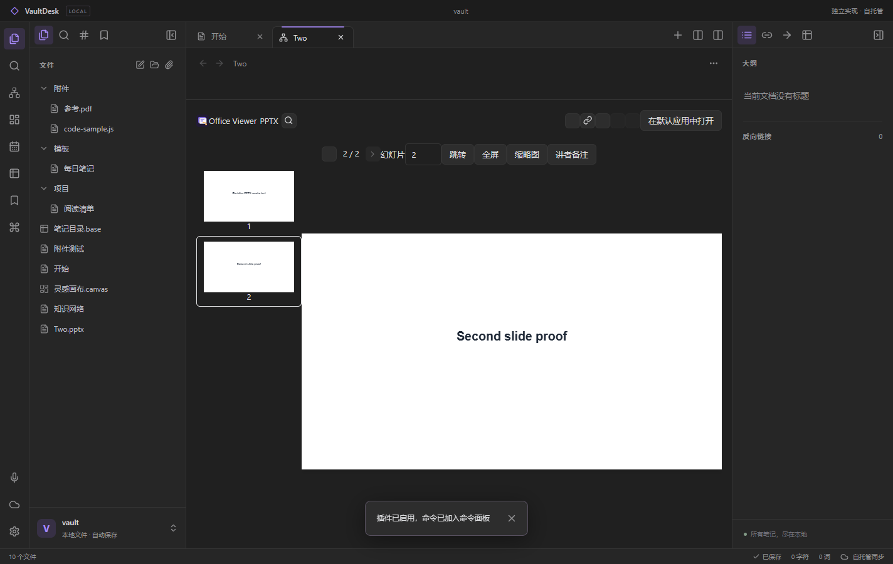
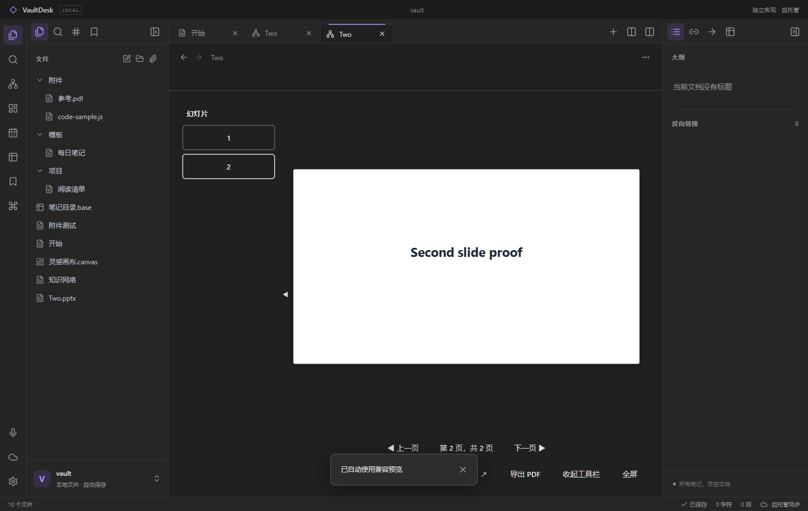

# Windows PPT 插件兼容追加

2026-10-24，VaultDesk 0.4.0。使用新建隔离知识库；原有知识库与插件发布源码未改动。

支持 Office Viewer 0.2.5（jerry4pan/obsidian-office-viewer-plugin）与 PPT Viewer 1.8.2（pherehouse/ppt-viewer）的有限 PPTX 阅读路径。导入 manifest.json、main.js、styles.css 后分别启用；两者注册同一扩展名，不能同时接管 pptx。

补齐 FileView、registerExtensions 路由和 onOpen→onLoadFile→onUnloadFile 生命周期；共享 CodeMirror state/view/language、编辑器扩展动态安装/移除与上下文字段；Scope 与 DOM 工厂；可选 CSS 安装和清理。path 仅为浏览器纯路径模块，没有开放 Node 文件系统与进程能力。

REA 6.7.0 驱动隔离控制页，由未修改的 Obsidian 1.13.7 执行合成 FileView 实验。观察到 onOpen 时 file 为 null，onLoadFile/onUnloadFile 时 this.file 与参数相同，getViewState 保留文件路径。运行日志与 REA 报告在 research/raw/windows-round3-ppt-fileview-20261024；此项不是在原版中运行两个真实插件。

PPT Viewer 的高保真转换首先因 fs 能力不可用失败，插件按其自身逻辑回退至 Windows 兼容预览；不能声称 PowerPoint/LibreOffice、PDF 导出或高保真排版已经支持。Office Viewer 的旧 .ppt 明确属于插件不支持格式；本次也没有验证 DOCX、复杂动画/媒体、远程链接、伴生笔记、系统打开与剪贴板。

两页合成 PPTX 从原测试 minimal.pptx 派生，仅复制第二页并更换正文；不是用户资料，也不是复杂格式代表。发布插件身份与原测试 provenance 参见 output/playwright/ppt-plugin-check-20261024-161019/result.json 和 fixture-provenance.md。后续打包实测原始记录保存在 research/windows-ppt-plugin-verification.json。

## 打包实测

两个未修改插件在 0.4.0 便携 EXE 中分别完成导入三文件、启用、第一页/第二页/返回、停用占位与 CSS 清理。两份截图经视觉复核，第二页正文实际可见；最初宿主高度压缩导致的空白画面已修复并用新隔离实例重跑。两页 PPTX 读取后哈希不变，页面异常为零。控制台原始消息保留在结构化记录中，不以页面异常零推断所有插件内部诊断为零。

全套 Node（含真实自有云集成）310/310 通过，零跳过。新增测试核对 FileView 生命周期、state.file、停用时 CSS/编辑器扩展清理。REA 证据 ID 为 `ev_82fde45c0717e528325d08a473da44af3843082bc099409f41a303b05bf511db`，原版正常退出且核心未改。

