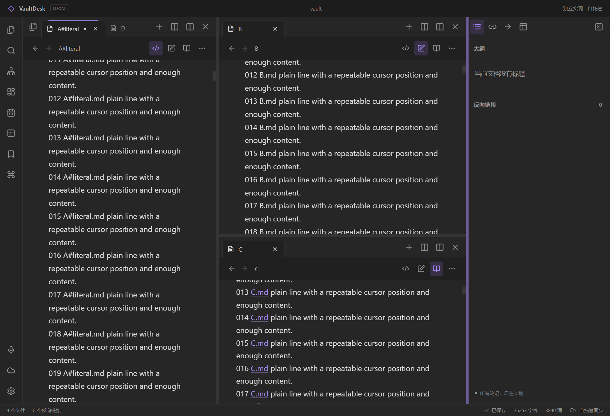

# Windows workspace layout verification

Verified on 2026-10-23 with Electron 42.11.9, Chromium 148.0.7778.280 and Node 24.19.0. The tests use synthetic vaults and separate desktop sessions. Existing application windows and user vaults are not used.

## Implemented behavior

- Recursive tab groups can combine left/right and top/bottom splits. Divider direction follows the original application's layout convention: `vertical` means left/right and `horizontal` means top/bottom.
- Mouse and keyboard resizing preserve ratios. Both paths enforce the same minimum pane size; sidebars resize from their actual visible width after a window-size change.
- Tabs can move within a group, between groups, or into a new edge split. A group that loses its final tab through a move is removed. Empty groups explicitly saved in a workspace remain present after restore.
- Pinning, active tabs, per-tab source/live/reading modes, selections, cursor offsets, editor scrolling, sidebar widths and collapse state are serializable.
- Named layouts wait for their workspace write before showing success. Loading a named layout explicitly reapplies saved editor state even when the pane and document path have not changed.
- Editor scroll restoration waits for CodeMirror's layout measurements. Reading mode retains the hidden source editor's own scroll target until that editor is shown.

The implementation uses character offsets for cursors and pixel offsets for scrolling. The reference application's ephemeral scroll state uses source-line units. These are different internal representations; this verification does not establish binary workspace compatibility, cross-DPI position equivalence or crash recovery equivalence.

## Model and browser checks

Run the model tests with:

```powershell
node --test tests/workspace.test.mjs tests/workspace-layout.test.mjs
```

All 29 tests passed. They cover migration from the earlier flat pane list, mixed split trees, drag docking, pin and tab-state transfer, literal `#` paths, primary selections, malformed trees, size normalization and JSON restoration. A separate seeded stress run completed 1,000 split/move/remove/resize sequences while checking tree invariants.

Run the browser component fixture with:

```powershell
node scripts/workspace-layout-browser-smoke.mjs
```

The runner starts its own Vite server and Chrome session and closes both afterward. It checks actual DOM geometry and native HTML drag events. All 27 main-flow checks and five geometry regressions passed. The fixture uses a controlled textarea for selection and scroll state; the native application checks below cover the real CodeMirror editor.

Evidence:

- `output/playwright/workspace-layout-report.json`
- `output/playwright/workspace-layout-probes.json`
- `output/playwright/workspace-layout.png`

The five geometry regressions cover the keyboard's 100-pixel minimum, visible right-sidebar content at an 800-pixel viewport, keyboard and pointer resizing after CSS width clamping, and top docking in a 113.25-pixel-high pane.

## Native application checks

After building the application, run:

```powershell
$env:VAULTDESK_LAYOUT_EMPTY = '1'
node scripts/desktop-layout-smoke.mjs
Remove-Item Env:VAULTDESK_LAYOUT_EMPTY
```

The runner uses four launches of an isolated native session and performs eight checks:

1. Restore a 37/63 left/right split containing a 61/39 top/bottom split, pinned tabs, three editor modes, initial scrolling and sidebar geometry.
2. Switch an initially reading-mode document to source and back while preserving both 650-pixel scroll positions.
3. Insert text at saved character offset 2000 in `A#literal.md` through Chromium input.
4. Switch tabs and restore the source editor's 777-pixel scroll position and the other tab's state.
5. Resize both nested dividers and a sidebar through native pointer events and verify saved values.
6. Save a named layout through the application UI and verify the written tree, tabs and sidebars.
7. Quit and restart, then verify layout, pinning, modes, scrolling and a second insertion at restored offset 2013.
8. Restore the same pane and path from a named layout, verify scrolling and insertion position, then restore an empty tab group and verify it after another restart.

Successful native testing against the development source is recorded in `output/layout-1792752144785-56c80e/report.json`, with screenshots beside it. All eight checks passed. The isolated main-process instrumentation recorded 16, 5, 8 and 3 workspace writes across the four launches. Every recorded write succeeded; no writes remained pending when quit was requested. The longest observed write was 51 milliseconds.

The built renderer `dist/assets/index-BnGz4Zji.js` also passed all eight checks in `output/layout-1792752416967-70e8fe/report.json`. Its four launches recorded 16, 5, 9 and 3 successful workspace writes, with zero pending writes when quit was requested and a maximum observed write time of 51 milliseconds. This result identifies that specific renderer build. Later changes require their own validation result.

The final packaged `VaultDesk.exe` version **0.3.1**, containing `index-CWnBlYx-.js`, passed the same eight checks in `output/layout-1792753258136-d2f0ce/report.json`. The test launched the packaged executable four times, without a development server. Those launches recorded 16, 5, 8 and 3 successful workspace writes, with zero pending writes when quit was requested and a maximum observed write time of 21 milliseconds. A disk read after the last process exited also confirmed the nested tree, all three groups, the empty group and both user-created named layouts. The portable evidence file `research/windows-round3-layout-verification.json` identifies the packaged renderer's SHA-256 and contains the finite check results without machine-specific absolute paths. This run covers the Markdown workspace scenarios described above. Custom plugin view cloning and cold restoration are outside this eight-check report and must be assessed using the separate plugin acceptance evidence.



The input driver waits for browser and CodeMirror focus/selection synchronization before typing. It does not replace the saved cursor with an expected value. The assertions check the resulting inserted text in the vault file.

The test can also use an explicitly supplied `VAULTDESK_LAYOUT_DEV_URL`. A development server used with Electron's existing content policy must disable Vite's inline Fast Refresh preamble; the verification server used `server.hmr: false`. The application content policy was not weakened for these tests.

`--editor-only` provides a focused six-check run that excludes named-layout saving and loading. It is not a substitute for the full eight-check result.

To run the same checks against a packaged application, set `VAULTDESK_LAYOUT_EXECUTABLE` to its absolute executable path as well as `VAULTDESK_LAYOUT_EMPTY=1`. The runner records the actual renderer URL and script filename so the result can be tied to the tested artifact.
