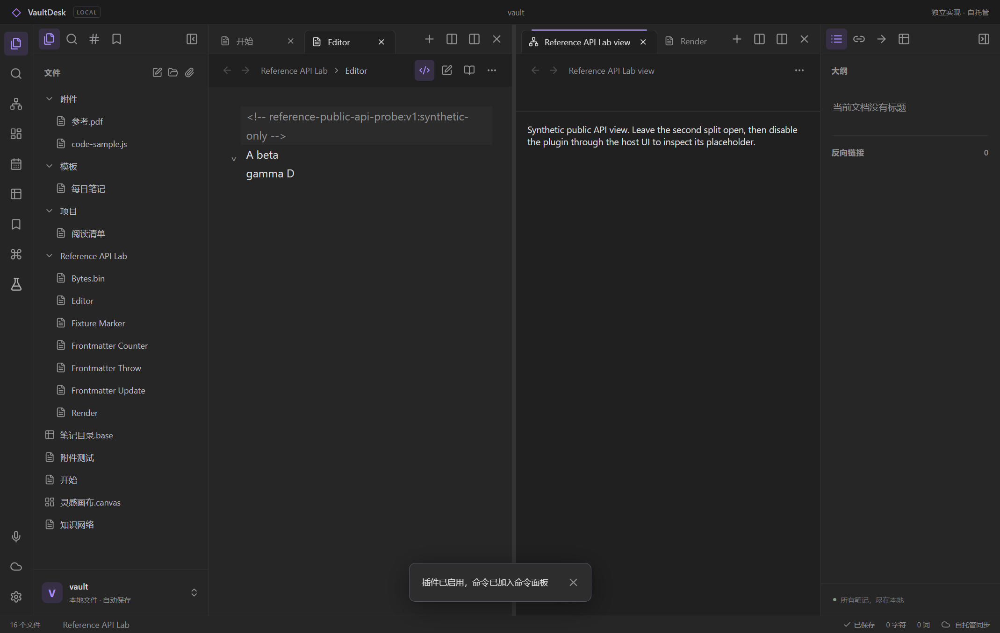

# Windows 第三轮：插件公开 API 桌面验收

日期：2026-10-23。独立应用通过真实 Electron 窗口加载最终 0.3.1 打包程序的 `release/VaultDesk-0.3.1-Windows-x64/resources/app/dist/index.html`，导入并明确启用冻结的合成插件 `public-api-probe`，从应用命令面板执行 01–05。插件记录的 **10 个场景、29 项断言全部通过**；同一份 manifest/main 在参考程序 1.13.7 中也得到 **10/10 场景、29/29 断言通过**。

这证明下表中的有限公开 API 路径可由真实插件加载器和应用界面执行。它不等于完整社区插件兼容，也不意味着两边所有 DOM、事件次数或序列化字段都相同。

## 证据与输入身份

- [独立桌面原始报告](../research/windows-round3-plugin-ui.json)：`scope` 记录生产页面 URL 和合成库，`report` 是插件报告，`before` / `after` 是外部停用观察，`console` 记录错误/警告，`verifiedAt` 是本次采集时间。控制台记录为 0 个错误、0 个警告。
- [参考程序同脚本报告](../research/windows-round3-wrapper-reference.json)：参考核心 1.13.7、Electron 39.8.3，包含原始 case、冻结输入摘要、生命周期、截图摘要与外部停用观察。
- [冻结插件](../research/windows-round3/fixtures/public-api-probe/README.md)：只导入 `obsidian`，所有文件写入限定在带固定 marker 的 `Reference API Lab` 合成目录；不删除文件。
- [独立桌面 UI 驱动](../scripts/plugin-ui-smoke.js)：接收现有 Playwright `page`，验证合成库路径后执行界面导入、启用、命令、停用并收集报告。
- [独立应用自定义视图截图](images/windows3-plugins.png) 与 [停用后占位截图](../output/windows3-plugin-disabled.png)。参考程序的 7 张截图及 SHA-256 在同脚本报告的 `screenshots` 中列出。

输入摘要已与当前仓库文件逐字节核对：

| 文件 | SHA-256 |
| --- | --- |
| `manifest.json` | `65e8d9c7c62b42d23cb2c1e302aa6fa7ce1e26727d9fc3b9c541c919117af1bd` |
| `main.js` | `7ef160da80a8005428d88eafdc20dbe0ee29dc7c7c065a91d448334c131f166d` |

独立应用通过本地插件界面导入/启用、通过应用命令面板触发、通过停用控件关闭。参考程序由 REA 控制的隔离探针调用真实插件管理器和命令注册表；没有直接调用 wrapper 内部方法，但也不是物理键鼠操作原版命令面板。两者运行相同插件源码，启动与控制方法不同。

最终独立桌面报告采集于 `2026-10-23T11:01:00.476Z`，报告的 `renderer` 确认打包版本为 `0.3.1`；主 bundle 为 `dist/assets/index-CWnBlYx-.js`，SHA-256 为 `d47b19986bd14bace1441fce3267eec7c3230d813e6d6de263b482801167277d`。对应输入摘要已存入报告的 `fixtureHashes`。

## 已通过的场景

| Case | 核验内容 | 断言数 | 独立应用 / 参考程序 |
| --- | --- | ---: | --- |
| `editor:prepare-marked-note` | 新建带 marker 的 Markdown，打开真实源码编辑器 | 1 | 通过 / 通过 |
| `editor:transaction-undo-redo` | 两处原坐标修改、一次 undo 恢复、redo 重放 | 3 | 通过 / 通过 |
| `view:split-state-and-detach` | 新标签与分屏、`onOpen` 先于 `setState`、关闭第一 leaf 不影响第二 leaf、触发 `onClose` | 4 | 通过 / 通过 |
| `resources:ribbon-status-click-remove` | Ribbon/状态项同步挂载、点击执行、临时元素移除 | 3 | 通过 / 通过 |
| `render:native-reading-context` | 原生阅读页代码块输入无尾换行、section 携带整篇源文、sortOrder 50 先于 100 | 3 | 通过 / 通过 |
| `render:programmatic-component-lifecycle` | `MarkdownRenderer.render` 生成自定义代码内容、虚拟 section 为 null、组件卸载其渲染子组件 | 3 | 通过 / 通过 |
| `frontmatter:update` | 回调一次、字段更新落盘、marker 与正文保留 | 3 | 通过 / 通过 |
| `frontmatter:throw-does-not-write` | 异常传播、原始字节不变 | 2 | 通过 / 通过 |
| `frontmatter:concurrent-counter` | 两个操作都完成、先后读到 0/1、最终计数 2 | 3 | 通过 / 通过 |
| `binary:arraybuffer-roundtrip-modify-append` | ArrayBuffer 返回、含 0/高位字节的创建/读取/修改/追加保持精确内容 | 4 | 通过 / 通过 |
| **合计** | | **29** | **10/10 场景均通过** |

额外逐字段核对显示：编辑器 before/after/undo/redo 的文本、选区和光标快照一致，公开 `transaction` 的返回类型均为 `undefined`；本例 frontmatter 输出字节一致；二进制初始、修改、追加后的数组一致。阅读代码块 section 两边均为完整源文以及 `lineStart:6, lineEnd:9`。参考程序与独立应用触发渲染回调的次数不同，不能把事件日志逐字节相等作为本轮结论。

## 停用的外部观察

停用前保留第二个自定义 leaf，状态为 `{marker:"<!-- reference-public-api-probe:v1:synthetic-only -->", value:"two"}`。停用后两边均保持该运行内的 leaf ID、自定义类型及状态，显示所属插件不可用的占位。独立应用的已挂载插件视图数为 0，Ribbon 项为 0，插件状态文本为空。参考程序的独立 `disableObservation` 同样记录 Ribbon/状态项移除。

这些结论来自宿主外部观察。插件自身 `onunload` 的保存记录只是最佳努力，不能单独证明后续清理已完成。占位文案、图标和 `getViewState` 的额外字段存在差异；不把这类表现差异算作 29 个语义断言的覆盖。

## 状态恢复与针对性测试

宿主还进行了公开 `changeLayout` 和应用命名布局的状态回归：同 leaf ID/同类型加载新的状态会调用现有实例的 `setState`；命名保存先捕获 `getState`；明确恢复会重新应用相同的已保存状态，即使视图内存已变化；普通布局通知不会重置未保存的视图状态。异步 `setState` 在同一实例上串行执行，最后请求的状态最后应用；序列化失败会阻止命名保存使用陈旧值。

`node --test tests/extensions.test.mjs tests/extensions-files.test.mjs tests/extensions-render.test.mjs tests/extensions-round3.test.mjs` 当前 **41/41 通过**。其中新增回归覆盖命名/公开布局恢复、异步状态顺序、捕获等待与失败，以及公开 `Editor.transaction` 的 void 返回契约。单元测试使用注入加载器/最小 DOM，桌面报告提供独立的生产加载器与真实界面证据。

工作区适配器另有 **11/11** 用例通过，布局模型另有 **20/20** 用例通过，覆盖自定义 payload、leaf 身份、分屏克隆与恢复等路径；这些计数与上方插件宿主用例分列。

## 最终桌面的命名布局与 HTTP 补充验收

同一最终 0.3.1 打包程序还运行了 [layout-http-probe](../research/windows-round3/fixtures/layout-http-probe/README.md)。[原始结果](../research/windows-round3-plugin-layout-http-ui.json) 采集于 `2026-10-23T11:01:21.061Z`，控制台同样为 0 错误/0 警告。它是独立应用补充验收，未在参考程序运行，不合并为上方同脚本 29 项断言。

- 自定义 counter 从 1 点击增加到 2；按钮仅改视图内存，没有主动请求保存。通过应用命名布局界面保存后，磁盘工作区包含 `synthetic-counter-view` 与 `{file:"Synthetic payload.md",count:2}`。
- 再点击增加到 3，恢复命名布局后，真实视图重新显示 2，验证捕获 live `getState` 与强制恢复相同保存状态的完整 UI 路径。
- 通过公开 `getLayout/changeLayout` 往返后，持久化类型仍是 `synthetic-counter-view`，`file` 字段保留为自定义 payload，计数仍为 2；没有被误认成 Markdown 文件。
- 真实 Node loopback 服务 `127.0.0.1:28773` 的 **4/4 HTTP 检查通过**：同一请求 promise 的响应/text/json/arrayBuffer、`request` 文本返回、`throw:false` 的 404、默认 HTTP 错误拒绝。

复现实验材料：[UI 驱动](../scripts/plugin-layout-http-ui-smoke.js)、[合成 HTTP 服务](../scripts/plugin-http-fixture.mjs)、[补充截图](../output/windows3-plugin-layout-http.png)。这组 HTTP 桌面输入只覆盖 200 JSON/文本和 404；超时、大小限制、二进制上传及跨源重定向清理另由针对性测试覆盖。

## 最终打包程序的分屏克隆与渲染器重载

0.3.1 的 [克隆与重载原始结果](../research/windows-round3-plugin-clone-cold-ui.json) 采集于 `2026-10-23T11:02:28.402Z`，控制台为 0 错误/0 警告。应用的分屏操作把内存计数为 3 的自定义视图克隆为两个各显示 3 的视图；只增加第二个视图后，两者分别显示 3 和 4。磁盘状态记录了两个不同的 pane ID 和自定义 leaf token，各自保留 `synthetic-counter-view`、`file:"Synthetic payload.md"` 与对应计数。

渲染器重载并明确重新启用插件后，两个视图恢复显示 3 和 4，记录的 pane ID、leaf token、类型与 payload 均与重载前一致。此项只验证 **渲染器重载加明确重新启用插件**，没有验证插件视图的进程重启恢复，也未在参考程序执行。复现实验材料：[UI 驱动](../scripts/plugin-clone-cold-ui-smoke.js)、[分屏克隆截图](images/windows3-plugin-clones.png)。

## 边界

- 这份冻结 wrapper 没有覆盖任意社区插件、私有 API、Node/Electron require、CodeMirror 扩展、CSS 插件安装、移动端或浮动窗口。
- 它没有测试所有 frontmatter 字节变体；注释、CRLF、BOM、非映射 YAML 的差分见 [第三轮差分记录](windows-round3-differential.md)。本实现有意保留未改字节与注释，拒绝非映射输入。
- 普通后处理子组件在停用时的释放时机并不完全照搬参考程序；本宿主主动卸载全部所属渲染子组件。实时预览普通源码代码块还不自动变成插件控件。
- HTTP 补充验收只覆盖上述 loopback 输入；版本冲突、后台/只读编辑器、异步状态竞态和错误清理另由针对性测试覆盖，不能从 wrapper 的 29 项断言推断它们均已接受相同的桌面交互测试。
- 兼容接口与明确不支持项见 [插件兼容范围](plugin-compatibility.md)。测试只执行合成插件，没有启用未知社区代码或连接真实账户。

